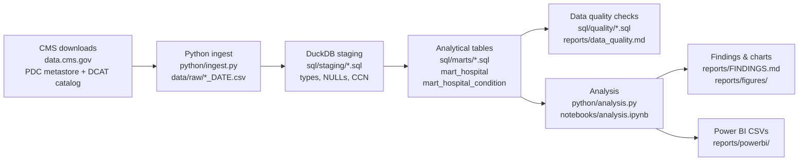
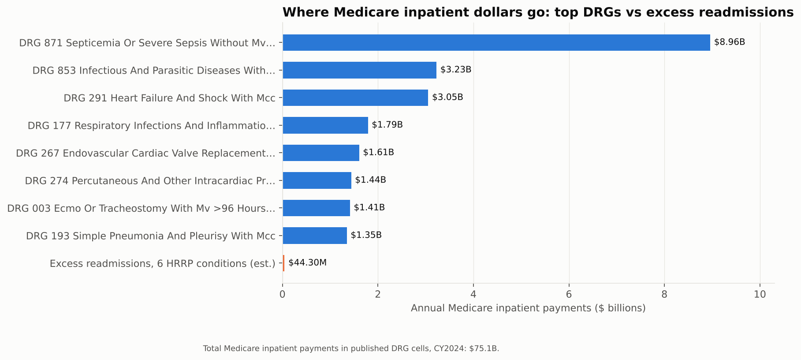
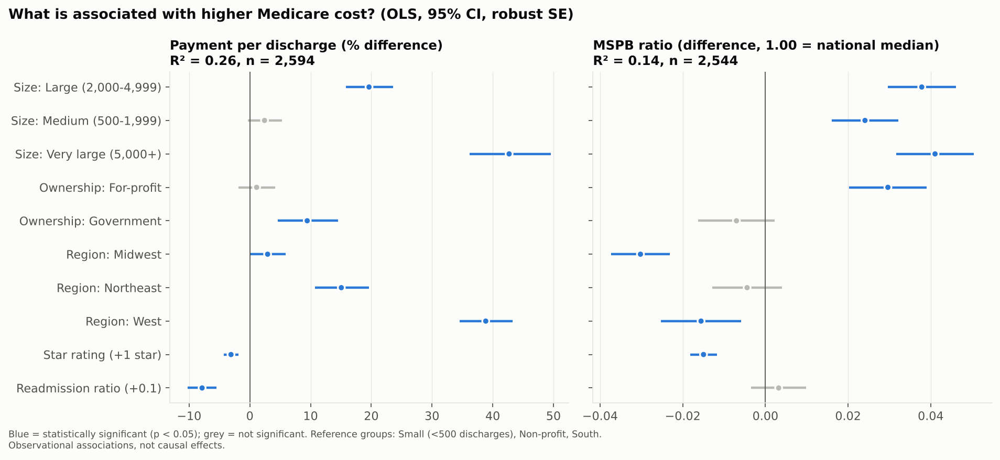

# Healthcare Operations Cost Analysis

An end-to-end analysis of public CMS data that finds what drives Medicare hospital costs across about 2,900 US acute-care
hospitals, and estimates what a realistic readmission-reduction program would save.

**Stack:** Python 3.11 · DuckDB (SQL engine) · pandas · statsmodels · scipy · matplotlib / plotly · Jupyter · Power BI-ready CSVs

> **Headline:** excess readmissions are **not** the top cost driver. They cost about **$44M a year, or 0.06%** of the
> **$75.1B** Medicare pays these hospitals for inpatient care. **Case mix** is the top driver: one DRG, sepsis, is 11.9%
> of all payments, and case mix accounts for about half of hospital-to-hospital variation in payment per discharge.
> **Regional price levels** come second.

---

## The problem

An operations team wants to know where hospital costs come from and whether to invest in reducing readmissions. The
specific questions:

1. Which cost components and hospital characteristics drive Medicare **payment per discharge** and **Medicare Spending
   Per Beneficiary (MSPB)**?
2. How much do **excess readmissions** cost, by condition and hospital segment?
3. Do **high-volume** hospitals perform differently from low-volume ones on readmissions?
4. What would a **10% cut in excess readmissions** at the highest-volume hospitals save?

## Data sources

Five public CMS files, all linked on the hospital CCN. Full URLs, versions and checksums are in
[`docs/DATA_SOURCES.md`](docs/DATA_SOURCES.md) and [`docs/source_manifest.json`](docs/source_manifest.json).

| Dataset | Period | Used for |
|---|---|---|
| Hospital General Information | current | state, type, ownership, star rating |
| Hospital Readmissions Reduction Program (FY2026) | Jul 2021 – Jun 2024 | readmission ratios, predicted/expected rates, discharges by condition |
| Medicare Inpatient Hospitals – by Provider and Service | CY2024 | discharges and payments by hospital × DRG |
| Medicare Spending Per Beneficiary – Hospital | CY2024 | MSPB ratio |
| Medicare Hospital Spending by Claim *(added)* | CY2024 | MSPB split into cost components (index stay, readmissions, skilled nursing, …) |

## Architecture



```
├── python/      ingest.py · transform.py (runs SQL + DQ) · analysis.py
├── sql/
│   ├── staging/ 00_macros … 07_stg_hrrp_drg_map    (one commented query per file)
│   ├── marts/   10_int_drg_national … 23_mart_cost_drivers
│   └── quality/ row counts · duplicate keys · join match rates · null rates · value checks
├── notebooks/   analysis.ipynb (executed; calls python/analysis.py)
├── reports/     FINDINGS.md · analysis_results.md · data_quality.md · results.json · figures/ · powerbi/
└── docs/        DATA_SOURCES.md · DECISIONS.md · source_manifest.json
```

**Analytical tables**
- `mart_hospital`: one row per hospital. Discharges, Medicare and total payments, payment per discharge, case-mix and
  price index, MSPB ratio and its components, readmission ratio for each condition, estimated excess readmissions and
  their cost, star rating, state, region, ownership, size band. Window functions add the hospital's rank within its
  state, its national percentile, and running shares of discharges and payments.
- `mart_hospital_condition`: one row per hospital per HRRP condition (AMI, HF, pneumonia, COPD, CABG, hip/knee).
  Ratios, rates, discharges, excess readmissions, cost per readmission (low/base/high), and percentile within the
  condition.

## How to run

Requires Python 3.11 and `make`. No credentials are needed.

```bash
make setup      # create .venv and install pinned requirements
make ingest     # download the CMS files to data/raw/ (about 55 MB)
make transform  # build data/healthcare.duckdb and run data quality checks -> reports/data_quality.md
make analyze    # statistics, charts, results tables, Power BI CSVs, and re-execute the notebook
# or: make all
```

For Power BI: load `reports/powerbi/hospital.csv` and `hospital_condition.csv`, and relate them on `ccn`. Set `ccn` to
the **Text** type so leading zeros are kept. `state_summary.csv` and `drg_national.csv` are also provided.

## Key findings

| | Result |
|---|---|
| Hospitals analysed | 2,906 IPPS hospitals; 4.95M Medicare discharges; **$75.1B** Medicare inpatient payments (CY2024) |
| Join match rate | **93.0%** of inpatient hospitals matched all three other sources (98.2% General Info, 96.0% HRRP, 95.9% MSPB) |
| **Top cost driver** | **Case mix.** Sepsis DRG 871 alone = $8.96B (11.9%). 25 of 540 DRGs = 50% of spend. Case mix accounts for 51% of the variance in payment per discharge and is the largest block in the regression (unique R² 0.37) |
| Second driver | **Region / price.** For the same case mix, West +25% and Northeast +18% vs South; Government-owned +11% and for-profit −5% vs non-profit |
| Regression R² | 0.26 with the requested predictors → **0.64** with case mix (0.77 with state fixed effects). MSPB model R² 0.14–0.16 |
| Excess readmission cost | **$44.3M/yr** (range $30.5M–$53.7M) = **0.06%** of inpatient payments. Heart failure $15.9M and pneumonia $15.8M = 72% |
| Readmission ratio vs cost | Significant in the simple model (−7.9% per +0.1), but **not significant** once case mix is controlled (−0.9%, p = 0.34) |
| MSPB components | Index stay = 45% of episode spend. Post-discharge inpatient care = 16% of spend but 22% of hospital-to-hospital variation. −0.015 MSPB per additional star |
| High vs low volume | Median readmission ratio 0.998 vs 0.994. Mann-Whitney p = 0.09, rank-biserial r = 0.05 (**negligible**) |
| **Savings scenario** | Top **402** hospitals (50% of discharges) cut excess readmissions 10% → **$1.9M/yr (range $1.3M–$2.4M)**, about 168 readmissions avoided |




More charts are in `reports/figures/`: cost by condition, savings range, state ranking, MSPB components, readmission
ratio by size, and an interactive state map (`state_map.html`). The executive summary is
[`reports/FINDINGS.md`](reports/FINDINGS.md), and every methodology choice is explained in
[`docs/DECISIONS.md`](docs/DECISIONS.md).

## Limitations

- **Medicare-only data.** Fee-for-service Medicare only, so no commercial, Medicaid or Medicare Advantage patients.
  "Cost" means what Medicare paid, not what the hospital spent to deliver care.
- **Observational, not causal.** The regression shows associations. Star rating, ownership and region are linked to
  many unmeasured factors (teaching status, payer mix, local wages).
- **CMS suppresses small counts.** Hospital × DRG cells with fewer than 11 discharges are not published, so small
  hospitals' totals are understated. HRRP discharge and readmission counts are suppressed when there are fewer than 11
  readmissions, so excess counts exist for 44% of hospital-condition rows. An upper bound for the suppressed rows adds
  less than $4.3M/yr.
- **Approximations.** Case mix is built from DRG mix and payments, not CMS's official weights. The cost of a readmission
  is approximated by the index condition's DRG payment. Readmission data (2021–24) and payment data (2024) cover
  different periods.
- **Maryland** is paid under an all-payer waiver and has no MSPB score. The regressions were re-checked without it and
  the conclusions don't change.

---

**Suggested resume bullet**

> Built a Python/DuckDB pipeline joining 5 CMS datasets (2,906 hospitals, $75B Medicare spend); found excess readmissions cost ~$44M/yr (0.06%), while patient case mix was the top payment driver (R² 0.26→0.64).
